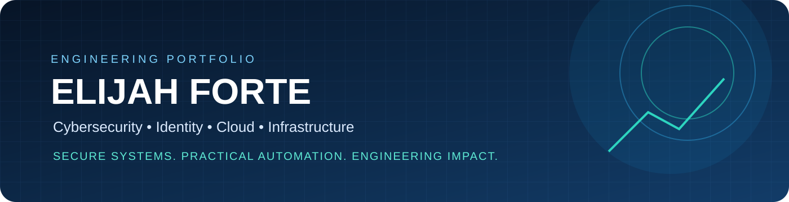
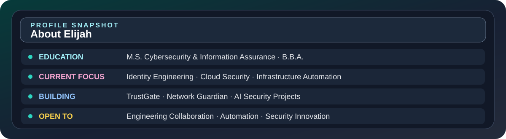
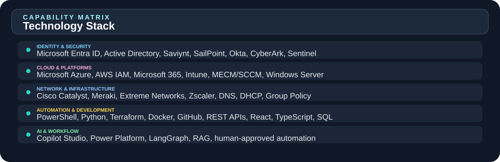
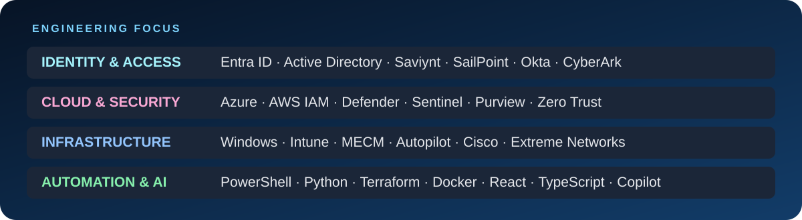

**Cybersecurity & Infrastructure Engineer | U.S. Army Veteran**

---

## 🤝 About Me

I build and support enterprise technology across **identity and access management, cloud security, infrastructure engineering, security operations, endpoint management, and automation**. My work connects hands-on operations with engineering: improving access governance, securing endpoints, troubleshooting enterprise platforms, and automating repeatable workflows.

I hold an **M.S. in Cybersecurity & Information Assurance** from Western Governors University and a **B.B.A. in Business Administration** from Strayer University. I am also a U.S. Army veteran.

Currently focused on identity governance, Microsoft security, enterprise networking, Windows endpoint modernization, vulnerability remediation, and AI-enabled IT operations.

---

## 🛠️ Tech Stack

<strong>Explore my detailed technology stack</strong>

| Domain | Tools and technologies |
|---|---|
| Identity & IAM | Entra ID, Active Directory, Saviynt, SailPoint, Okta, Ping Identity, CyberArk, SAML, OIDC, OAuth, SCIM, PIM, RBAC |
| Microsoft & Cloud | Azure, AWS IAM, Microsoft 365, Defender, Sentinel, Purview |
| Security & GRC | Splunk, KQL, NIST CSF 2.0, NIST 800-171, NIST 800-207, PCI DSS, HIPAA, CIS Benchmarks |
| Endpoint & Infrastructure | Intune, MECM/SCCM, Autopilot, Windows Server, Group Policy, Cisco Catalyst, Meraki, Extreme Networks, Zscaler |
| Automation & Development | PowerShell, Python, Microsoft Graph, Terraform, Docker, Git, GitHub, JavaScript, TypeScript, React, SQL, REST APIs |
| AI & Workflow | Copilot Studio, Power Platform, LangGraph, RAG, n8n, human-in-the-loop controls |

---

## 🚀 Latest Innovation

**Building enterprise IT automation with Windows desktop tooling, a React portal, .NET APIs, and audit-oriented workflows.**

## 🎯 Engineering Focus

- **Identity & access:** Microsoft Entra ID, Active Directory, Saviynt, SailPoint IdentityIQ, Okta, CyberArk, SSO, MFA, RBAC, PIM and lifecycle automation.
- **Cloud & security:** Azure, AWS IAM, Microsoft Defender, Microsoft Sentinel, Microsoft Purview, Zero Trust and control mapping.
- **Infrastructure & endpoints:** Windows Server, Intune, MECM/SCCM, Autopilot, Cisco Catalyst, Cisco Meraki and Extreme Networks.
- **Automation & engineering:** PowerShell, Microsoft Graph, Python, Terraform, REST APIs, GitHub, Docker, React and TypeScript.
- **AI-enabled operations:** Copilot Studio, Power Platform, LangGraph, retrieval-augmented generation and human-approved automation.

---

## 🧩 Featured Engineering Projects

Projects below highlight practical engineering work, labs and portfolio builds. Scope and implementation status are described in each repository.

| Project | What it demonstrates |
|---|---|
| [TrustGate](https://github.com/IAMShade-01/TrustGate) | Enterprise IT automation concept with a Windows desktop client, WinGet workflow, React portal, .NET API architecture and audit-oriented workflows. |
| [Network Guardian](https://github.com/IAMShade-01/Network-Guardian) | AI-assisted security and network defense engineering. |
| [Azure IaC Identity Guardrails](https://github.com/IAMShade-01/azure-iac-identity-guardrails) | Terraform and Azure Policy guardrails for identity and storage security. |
| [Sentinel Detection Rules](https://github.com/IAMShade-01/sentinel-detection-rules) | Microsoft Sentinel analytics and security detection engineering. |
| [Entra ID Automation](https://github.com/IAMShade-01/entra-id-automation) | Identity administration and automation using Microsoft technologies. |
| [Conditional Access as Code](https://github.com/IAMShade-01/conditional-access-as-code) | Repeatable identity security policy and configuration work. |
| [AI Security Guardrails](https://github.com/IAMShade-01/ai-security-guardrails) | Application-level safeguards for AI systems. |
| [Active Directory Homelab](https://github.com/IAMShade-01/Active-Directory-Homelab) | Directory services, Windows infrastructure and security lab work. |

---

## 🏅 Certifications & Professional Credentials

**Security Engineering** · **Cloud & Microsoft** · **Identity & Access** · **Infrastructure**

### Featured credentials

| Credential | Award / status |
|---|---|
| **CompTIA SecurityX (CAS-005)** | Certified October 4, 2026 · Valid through October 4, 2029 |
| **CompTIA Security Analytics Expert (CSAE)** | Stackable designation · October 4, 2026 |
| **CompTIA Secure Infrastructure Expert (CSIE)** | Stackable designation · October 4, 2026 |
| **SailPoint Identity Security Leader Credential** | Completed October 16, 2026 |
| **CyberArk PAM Solution Training** | Completed October 2, 2026 |

### Additional certifications

<strong>CompTIA · Microsoft · ISC2 · Linux</strong>

| Area | Credentials |
|---|---|
| CompTIA | Security+ · CySA+ · PenTest+ · CNSP · CNVP · CSAP |
| Microsoft | Azure Administrator Associate (AZ-104) · Identity and Access Administrator Associate (SC-300) |
| Microsoft Fundamentals | Azure Fundamentals (AZ-900) · Azure AI Fundamentals (AI-900) |
| Security | ISC2 Certified in Cybersecurity (CC) |
| Linux | Linux Essentials (LPI) |

[**Explore the full certification index →**](certificates/README.md)

---

## 🎓 Education

- **M.S. in Cybersecurity & Information Assurance** — Western Governors University · September 9, 2026
- **B.B.A. in Business Administration** — Strayer University · December 2024
- **Associate in Arts, Business Administration** — Strayer University · September 2023

---

## 💼 Professional Experience

- **Infrastructure Support — John Deere:** enterprise networking, identity governance, Windows endpoint engineering, vulnerability remediation, incident response, automation and IT operations.
- **Service Desk Specialist — NC Electric Membership Corporation:** Entra ID and Active Directory administration, SSO onboarding, identity lifecycle automation, security operations and endpoint modernization.
- **Desktop Support — Novo Nordisk (contract):** regulated manufacturing IT, IAM/PAM support, endpoint engineering and vulnerability scanning.
- Earlier experience across telecommunications, enterprise help desk and U.S. Army transportation operations.

---

## 📊 GitHub Activity

---

## 📫 Connect With Me

*Building secure systems. Automating the repeatable. Engineering what comes next.*

